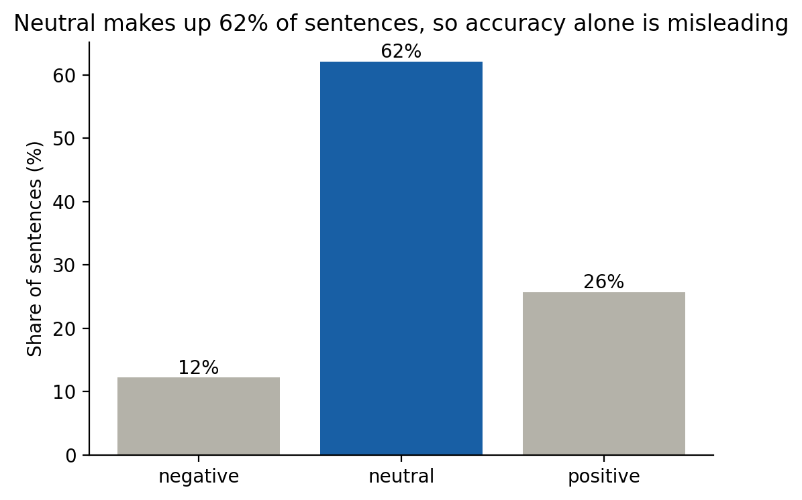
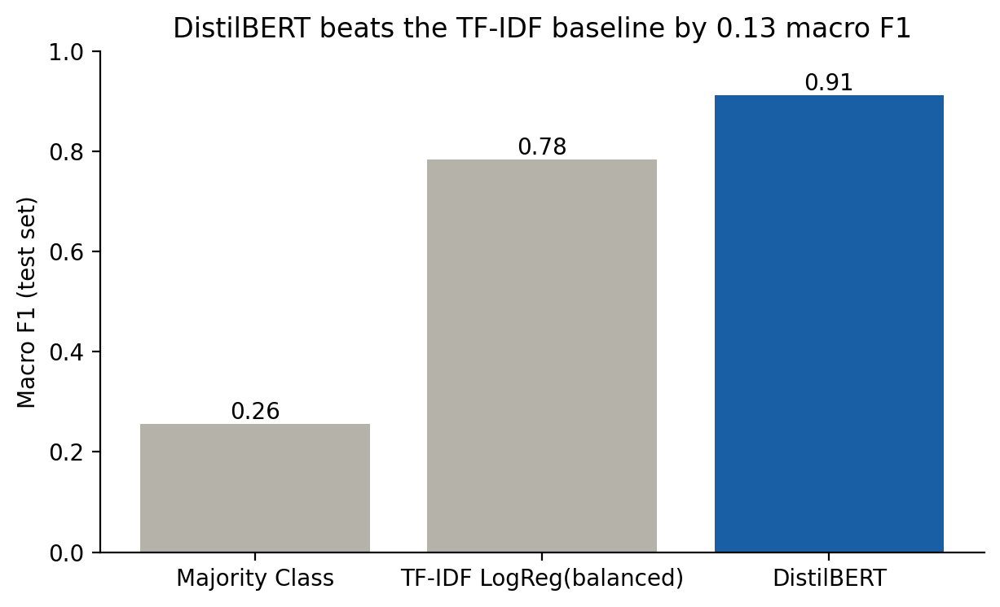
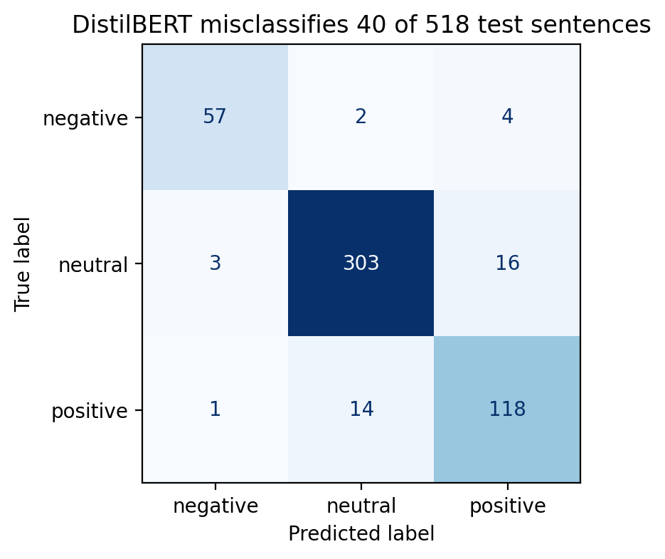
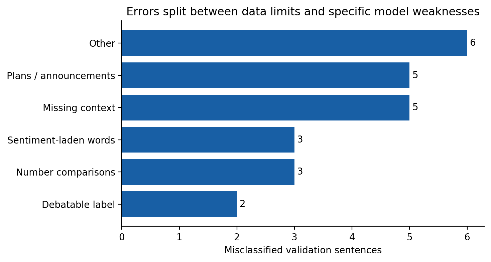

# Financial News Sentiment Classification with DistilBERT

Classifying sentences from financial news as **negative**, **neutral** or **positive**.
A fine-tuned DistilBERT model reaches **0.91 macro F1** on a held-out test set, compared with **0.78** for a TF-IDF Vectorizer + logistic regression baseline.

| Model | Accuracy | Macro F1 |
|---|---|---|
| Majority class (always "neutral") | 0.622 | 0.256 |
| TF-IDF + Logistic Regression (balanced) | 0.834 | 0.784 |
| **DistilBERT (fine-tuned)** | **0.923** | **0.912** |

*All scores are on the test set (518 sentences), which was used once, after every modeling decision was final.*

---

## Dataset

**Financial PhraseBank** (Malo et al., 2014): 4,846 English sentences from financial news, each labeled by 5–8 annotators with a finance background. The label reflects the annotators' judgment of how the news would affect the company's stock price.

The dataset is published in four tiers by annotator agreement:

| Tier | Sentences |
|---|---|
| 50% agree | 4,846 |
| 66% agree | 4,217 |
| **75% agree (used)** | **3,453** |
| 100% agree | 2,264 |

I used the **75% agreement** tier as a balance between data volume and label quality. After removing 5 exact duplicates, 3,448 sentences remain.

**Why not the Kaggle version?** I started with the widely used Kaggle "Financial Sentiment Analysis" CSV. On inspection, it turned out to silently merge two sources (FiQA and Financial PhraseBank), and about 514 sentences appear with conflicting labels, almost always neutral vs. negative, because the two sources draw that line differently. I switched to the original Financial PhraseBank to avoid training on contradictory labels.

---

## Approach

### Class imbalance and metric choice



62% of sentences are neutral, so a model that always answers "neutral" is already 62% accurate while being useless. I therefore use **macro F1** as the main metric: it scores each class separately and averages them, so the small negative class counts as much as neutral. 

(Macro F1 = (F1 negative + F1 neutral + F1 positive) / 3). 
For example, the always-neutral model scores (0 + 0.77 + 0) / 3 = 0.26, despite 62% accuracy.

Alternatives won't work here: accuracy and weighted F1 are both dominated by the neutral majority, and error measures like MSE treat the labels as numbers on a scale, although they are categories.

### Splits

Stratified 70 / 15 / 15 split (fixed random seed), keeping the same class proportions in every split:

| Split | Sentences | Role |
|---|---|---|
| Train | 2,414 | Fitting the models |
| Validation | 516 | Model choices and error analysis |
| Test | 518 | Final evaluation, used once |

### Models

1. **Majority class**: always predicts neutral. Shows the floor.
2. **TF-IDF + Logistic Regression**: a classic bag-of-words baseline, built as a scikit-learn `Pipeline`. Without class weighting it mostly defaulted to neutral (negative recall 0.48, macro F1 0.74 on validation). `class_weight="balanced"` raised validation macro F1 to 0.81, so that version was kept.
3. **DistilBERT** (`distilbert-base-uncased`): fine-tuned with the Hugging Face `Trainer` for 3 epochs (learning rate 2e-5, batch size 16, max length 128 tokens). Validation macro F1 rose every epoch, with no sign of overfitting.

---

## Results



| Model | Macro F1 | F1 negative | F1 neutral | F1 positive |
|---|---|---|---|---|
| Majority class | 0.256 | 0.000 | 0.767 | 0.000 |
| TF-IDF + LogReg (balanced) | 0.784 | 0.732 | 0.894 | 0.725 |
| DistilBERT | **0.912** | **0.919** | **0.945** | **0.871** |

- DistilBERT beats the baseline by **+0.13 macro F1**. The largest gain is on the smallest class, **negative** (+0.19).
- Both models scored about 0.03 lower on test than on validation (DistilBERT 0.937 → 0.912). That is expected, as validation guided the modeling choices, and with only 63 negative test sentences, a few errors move the score noticeably.

---

## Error analysis



The most common confusion is between **neutral and positive**. To understand *why* the model fails, I read all 24 misclassified validation sentences and tagged each with the most likely cause:



| Category | Errors | Finding |
|---|---|---|
| Missing context | 5 | The sentence is a fragment ("However, …", "since then") whose meaning depends on the previous sentence. |
| Plans / announcements | 5 | Errors go both ways: annotators treated some plans as good news and others as neutral, and the model cannot learn where that line is. |
| Number comparisons | 3 | All complete flips (negative ↔ positive). The sentiment depends on whether figures went up or down (e.g. a loss growing from EUR 65mn to 117mn), which the model does not read reliably. |
| Sentiment-laden words | 3 | Neutral facts containing emotionally charged words ("awards", "ban") were predicted positive or negative. |
| Debatable label | 2 | The human label itself is arguable. In both cases the model predicted neutral. |
| Other | 6 | No clear pattern. |

**Takeaway:** 7 of the 24 errors (missing context and debatable labels) are limits of sentence-level data rather than of the model. The clearest model weaknesses are reading numeric comparisons and reacting to individual sentiment words.

---

## Limitations

- **Not stock prediction.** The labels are human judgments of how news *might* affect a stock, not actual price movements.
- **Old data.** The sentences come from news before 2014; financial vocabulary and companies have changed since.
- **Sentence level only.** Each sentence is classified in isolation, which causes the "missing context" errors above.
- **Small test set.** With 518 test sentences (63 negative), per-class scores have noticeable uncertainty.

---

## Project structure

```
data/
  raw/        Financial PhraseBank source files, README and license
  splits/     train.csv, val.csv, test.csv
src/
  utils.py           shared paths and helper functions
  data_eda.py        exploration, splitting, baseline models
  model.py           DistilBERT fine-tuning
  analysis.py        validation error analysis
  eval_test.py       final evaluation of all models on the test set
  visualization.py   charts in figures/
outputs/      result tables and error-analysis CSVs
figures/      charts used in this README
```

Model weights (`results/`, `models/`) are not included in the repository; they are recreated by running the scripts.

## How to run

```bash
pip install pandas scikit-learn matplotlib joblib torch transformers datasets

python src/data_eda.py        # splits the data, trains and saves the baseline
python src/model.py           # fine-tunes DistilBERT (about 4 minutes on an Apple-silicon laptop)
python src/analysis.py        # validation error analysis
python src/eval_test.py       # final test evaluation
python src/visualization.py   # regenerates the charts
```

Training on different hardware can give slightly different scores.


## Data source

Malo, P., Sinha, A., Korhonen, P., Wallenius, J., & Takala, P. (2014). *Good debt or bad debt: Detecting semantic orientations in economic texts.* Journal of the Association for Information Science and Technology, 65(4), 782–796.

The dataset's original README and license are in `data/raw/`.
